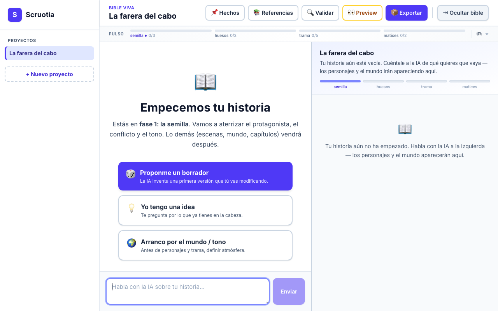

# Scruotia

Outline a novel by talking to an AI. You tell the story; the AI keeps a structured story bible up to date, written in plain language instead of database fields.



> The UI is in Spanish (it was built for Spanish-speaking writers). Code, comments and docs are in English.

## Features

- **Chat-first outlining.** One continuous conversation per project. Three ways to start: "propose a draft", "I have an idea", or "start from world and tone".
- **Live story bible.** Characters, places, plot, tone and secondary elements (rules, motifs, threads, factions, relationships) appear on the right as you talk, grouped as *who / where / what happens / tone* instead of entity types.
- **Phases with soft gates.** Seed, Bones, Plot, Nuances. A "pulse" bar shows coverage per phase and flags empty entities, open "Pendiente" notes and broken links.
- **Entity detail modal.** Full structured sheet per entity, view or edit as Markdown, lock as canon, contextual "ask the AI" actions (deepen, variants, backstory, voice).
- **Variants and history.** Generate alternative versions of a field in a throwaway branch, compare and apply one. Every write snapshots the previous file, and you can restore it with one click.
- **Canonical facts.** Immutable facts the AI extracts (or you add) are injected into every future turn.
- **Validation.** A structured audit: contradictions, loose ends, missing links, density, next steps.
- **Style references.** Upload `.md`/`.txt` samples so the AI matches your voice.
- **Export.** One dense Markdown bundle meant as the contract for writing the first draft.
- **Plain files.** Everything lives in Markdown + YAML under `projects/<slug>/`, so it diffs well with git.

## Requirements

- Node.js 20+ and pnpm
- [Claude Code](https://docs.claude.com/en/docs/claude-code) installed and logged in with your own account

There is **no API key** in this project. The app uses the [Claude Agent SDK](https://www.npmjs.com/package/@anthropic-ai/claude-agent-sdk), which picks up the credentials created by `claude login` on your machine (your own Claude subscription). Nothing is stored in the repo.

## Run it

```bash
pnpm install
claude login          # once, if you have not logged in yet
pnpm dev              # http://localhost:3000
```

Optional settings (see `.env.example`):

| Variable | Default | Purpose |
| --- | --- | --- |
| `SCRUOTIA_PROJECTS_DIR` | `./projects` | Where project folders are stored |
| `DEBUG_CLAUDE_SDK` | unset | Log unhandled Agent SDK events |

Other scripts:

```bash
pnpm typecheck        # tsc --noEmit
pnpm lint             # eslint
pnpm test             # vitest (unit tests, no network)
pnpm build            # production build
pnpm smoke:claude     # one real round-trip through the Agent SDK
```

## How it works

**1. The model answers in prose and emits silent fenced blocks.** The chat route (`app/api/chat/route.ts`) builds a system prompt with the current bible, the outline phase, the canonical facts and the per-type templates. The model replies normally, and when something in the story changes it adds blocks like these:

```text
~~~scruotia-card personaje:mara
name=Mara
icon=🧭
---
La farera que no quería visitas.
- **Rol:** protagonista
- **Want:** que la dejen en paz
~~~

~~~scruotia-patch personaje:mara
backstory=<<<
Treinta años sola en el cabo.
>>>
~~~

~~~scruotia-link personaje/mara lugar/faro
label=vive en
~~~

~~~scruotia-fact
Mara tiene 64 años cuando empieza la novela.
~~~
```

`lib/doc-updates.ts` parses them while the response streams, strips them from the visible text and turns them into cards, field patches, links, deletes, facts and clickable suggestions. The parser is deliberately tolerant: it normalizes loose identifiers (`"Mara Y Tito"` becomes `mara-y-tito`), accepts heredoc values, and still understands an older `<<<CARD:…>>>` syntax with 2 or 3 chevrons for when the model drifts.

**2. Field-level patches, not rewrites.** `lib/body-fields.ts` parses an entity body into intro, `- **Key:** value` fields, `##` sections and a trailing `**Pendiente:**` line. A PATCH merges by normalized key (case and accent insensitive), so "expand only the Want" never clobbers the rest of the sheet. Render, then parse, then render again gives the same output, which the tests check.

**3. Storage is the filesystem.** Each entity is one Markdown file with YAML frontmatter:

```text
projects/<slug>/
  manifest.yaml
  entities/<type>/<slug>.md       # the story bible (18 entity types)
  00-premise/facts.md             # canonical facts
  references/                     # style samples
  99-ai/main.json                 # the conversation
  99-ai/raw-turns/                # untouched model output, for debugging
  .history/<type>/<slug>/<ts>.md  # automatic snapshots before every write
```

**4. The narrative view is derived, not stored.** `lib/narrative.ts` and `lib/pulse.ts` compute the human-facing canvas (character essence, world paragraph, beat tracker, phase coverage, ghosts, open notes) from the same files on every load.

## Project structure

```text
app/
  api/chat/                 streaming chat + protocol application
  api/inline-ai/            one-shot AI actions from the entity modal
  api/projects/[slug]/      graph, entity, facts, references, validate,
                            export, lock, history, branches, preview
  components/               ChatColumn, NarrativeCanvas, EntityModal, StoryPulse, ...
  p/[slug]/                 desktop project view
  m/[slug]/                 mobile chat view
  new/                      new project form
lib/
  claude.ts                 Agent SDK wrapper (streaming, no tools)
  doc-updates.ts            protocol parser
  body-fields.ts            parse / render / merge entity bodies
  entities.ts, history.ts   file storage + snapshots
  entity-types.ts           templates per entity type
  phases.ts, pulse.ts       outline phases and health checks
  branches.ts               throwaway variant branches
  __tests__/                vitest suites
templates/methodologies/    snowflake method definition
projects/                   your projects (git-ignored)
```

## Limitations

- Single user, local only. No auth and no database, so do not expose it on a network.
- Every chat turn is a full Agent SDK call with the serialized history, and long conversations get slow.
- Some older "step views" from the first, wizard-style version are still in the codebase.

## License

MIT, see [LICENSE](LICENSE).
